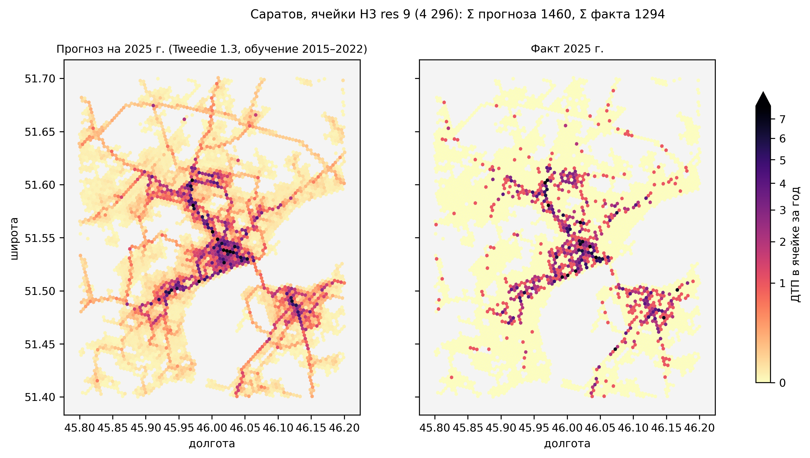

# Прогноз аварийности по дорожной сети

Курсовой проект по пространственному машинному обучению. По характеристикам дорожной сети модель CatBoost оценивает годовое число ДТП в ячейках H3 и ранжирует их для обследования. Исследование началось с Саратова, затем я проверил перенос модели на 14 крупных городах Поволжья.



На карте слева прогноз для Саратова на 2025 год, справа зарегистрированные ДТП за тот же год. Модель обучена на данных 2015–2022 годов.

## Что я сделал

- **Подготовил данные.** Собрал годовую панель H3 из карточек ДТП и дорожной сети. В выборках по 14 городам оказалось 154 611 ДТП за 2015–2025 годы. Проверил соответствие координат современной сети: на 2015–2016 годы пришлось 19,1% событий, но 73% всех событий вне дорожных ячеек. Проверка качества модели не показала общего выигрыша от исключения этих лет. [Данные и аудит](docs/analysis/multicity_350k/README.md)
- **Построил признаки дорог.** Посчитал длины и доли классов дорог, перекрёстки, примыкания, переходы и параметры геометрии сети. Для локальных экспериментов в Саратове также исследовал рельеф и паспортные характеристики СКДФ. [Этапы работы с признаками](docs/analysis/features/PLAN.md)
- **Проверил модели и простые ориентиры.** Сравнил бинарные и счётные постановки, выбрал годовую модель CatBoost с функцией потерь Tweedie. В Саратове сравнил структурный прогноз с ранжированием по истории ДТП и их сочетанием по эмпирическому Байесу. [Выбор модели](docs/analysis/features/stage7_count12/models/README.md) · [Сравнение с историей ДТП](docs/analysis/features/stage7_count12/history_eb/README.md)
- **Проверил перенос.** Обучал модель на других городах и оценивал на полностью исключённом городе. Для переноса использовал 28 признаков дорожной сети из OSM. Отдельно проверил влияние равных весов городов. [Протокол переноса](docs/analysis/multicity_350k/README.md) · [Равные веса городов](docs/analysis/multicity_350k/equal_city_weights/README.md)
- **Посчитал кратчайшие пути.** Построил автомобильный граф OSM без служебных дорог (`highway=service`) и нашёл пути с минимальной стоимостью проезда. Долю маршрутов через каждую ячейку H3 использовал как признак потенциального движения. Проверил его вклад в прогноз ДТП на 14 городах. [Маршрутный эксперимент](docs/analysis/route_proxy/README.md)

## Результаты

`coverage@10` — доля зарегистрированных ДТП в 10% ячеек с самым высоким прогнозом. Обучение на данных 2015–2022 годов, оценка на 2023–2025 годах.

| Что проверил | `coverage@10` |
| --- | ---: |
| Саратов: прогноз на будущие годы для знакомой территории | 67,4% |
| Перенос CatBoost по признакам OSM, среднее по 14 исключённым городам | 60,65% |
| Тот же межгородской протокол с маршрутным признаком по классу дорог | 60,87% (+0,22 п.п.) |

Локальная и межгородская оценки используют разные границы территории и наборы признаков. Сравнение маршрутных вариантов проведено на одинаковых городах и ячейках. В межгородской оценке каждому городу дан одинаковый вес. [Саратовский эксперимент](docs/analysis/features/stage7_count12/models/README.md) · [Таблица переноса по городам](reports/route_proxy_experiments/evaluation_no_service/city_paired.csv)

### Отдельный эксперимент с маршрутами

Построил направленный граф OSM, исключил `highway=service` и методом Дейкстры посчитал пути между заданными парами точек. По доле путей через ячейку получил прокси потенциального движения. Базовая стоимость по классу дала небольшой прирост (`+0,22` п.п. в среднем), уточнённая по OSM и СКДФ — `+0,06` п.п. Это сравнение на одной выборке пар точек. [Карта проходов](docs/analysis/route_proxy/figures/saratov-core-h3.png) · [Код расчёта](scripts/run_route_proxy_h3.py) · [Сводка](reports/route_proxy_experiments/evaluation_no_service/summary.csv)

## Код и данные

[Пакет Python](src/road_accident_risk/) · [Извлечение признаков для городов](scripts/multicity_features.py) · [Межгородская модель](scripts/multicity_models.py) · [Журнал экспериментов](EXPERIMENTS.md)

В работе над проектом использовал LLM-инструменты **Codex** и **Claude Code**.

### Исходные данные

| Источник | Что использовал |
| --- | --- |
| Карточки ДТП, 2015–2025 | Даты и координаты для годовых счётчиков по H3. Исходный `dataset.json` хранится локально. |
| OpenStreetMap, снимок 03.06.2026 | Границы городских округов, геометрия и характеристики дорог. |
| СКДФ | Паспортные характеристики дорог в части саратовских и маршрутных экспериментов. |

Исторические ДТП сопоставлялись с современной дорожной сетью. Изменения сети и ошибки координат могут влиять на результат сопоставления. [Описание границ и данных](docs/analysis/multicity_350k/README.md#2-протокол-и-география) · [Сопоставление OSM и СКДФ](docs/analysis/route_proxy/coverage/README.md)

Следующий шаг — повысить полноту дорожных признаков. Для многих участков не хватает сведений о покрытии, полосности, ширине и ограничениях скорости. Стоит проверить спорные совпадения OSM и СКДФ, уточнить значения там, где есть надёжные данные, и повторить проверку на городах, исключённых из обучения. Это покажет, насколько улучшение данных помогает расчёту стоимости проезда и прогнозу ДТП.

### Как проверить результат

Карты и итоговые CSV можно открыть сразу. Для повторного обучения на подготовленных данных нужны Python 3.11+, зависимости и локальные таблицы из [протокола эксперимента](reports/route_proxy_experiments/evaluation_no_service/protocol.json). Пример запуска одного саратовского теста:

```bash
python scripts/evaluate_route_proxy_multicity.py --target saratov --seeds 42 \
  --profiles baseline strict --out reports/route_proxy_experiments/saratov_example
```

Команда использует годовые счётчики и признаки из `reports/multicity_350k/`, маршрутные признаки из `reports/route_proxy_experiments/h3_no_service/` и сохранённый контроль без маршрутного признака. Тестовый город — Саратов. Инструкции по установке и подготовке исходных карточек ниже.

<details>
<summary>История проекта и подготовка исходных данных</summary>

## Что лежит в проекте

- `src/road_accident_risk/` - основной Python-пакет с воспроизводимой логикой.
- `main.py`, `to_parq.py`, `slim_parq.py`, `to_h3_month.py` - старые совместимые entrypoint-скрипты. Они сохранены и теперь делегируют в пакет.
- `logreg.ipynb`, `temp.ipynb` - исследовательские ноутбуки.
- `dataset.json` - исходный большой JSON, локальный артефакт.
- `parquet_output/` - локальные parquet-артефакты пайплайна.

## Пайплайн

1. Построить схему исходного JSON:

```bash
python main.py
```

или:

```bash
python -m road_accident_risk.schema_inference
```

2. Разложить `dataset.json` в нормализованные parquet-таблицы:

```bash
python to_parq.py
```

Результаты:

- `parquet_output/crashes.parquet`
- `parquet_output/vehicles.parquet`
- `parquet_output/persons.parquet`

3. Собрать компактную таблицу ДТП:

```bash
python slim_parq.py
```

Результат:

- `parquet_output/crashes_slim.parquet`

4. Собрать H3 x month panel:

```bash
python to_h3_month.py
```

По умолчанию используется bbox Саратова и H3 resolution 9. Для более честных negative examples можно включить все H3-ячейки bbox:

```bash
python to_h3_month.py --include-all-h3-cells-in-bbox
```

5. Запустить baseline логистической регрессии:

```bash
python scripts/run_logreg_baseline.py
```

или после установки пакета:

```bash
road-accidents-logreg
```

## Установка

Для текущей локальной работы достаточно существующего `venv`. Для новой среды:

```bash
python -m venv venv
source venv/bin/activate
python -m pip install -r requirements.txt
```

Для установки пакета в editable-режиме:

```bash
python -m pip install -e ".[notebook]"
```

## Важные детали данных

В исходнике scalar-поля `LAT` и `LNG` перепутаны: `LAT` содержит longitude, `LNG` содержит latitude. В `slim`-этапе это учтено так:

- `lat = POINT_LAT`, fallback на `LNG`
- `lng = POINT_LNG`, fallback на `LAT`

Поэтому downstream-код должен использовать `crashes_slim.parquet`, а не напрямую `LAT/LNG` из `crashes.parquet`.

</details>
