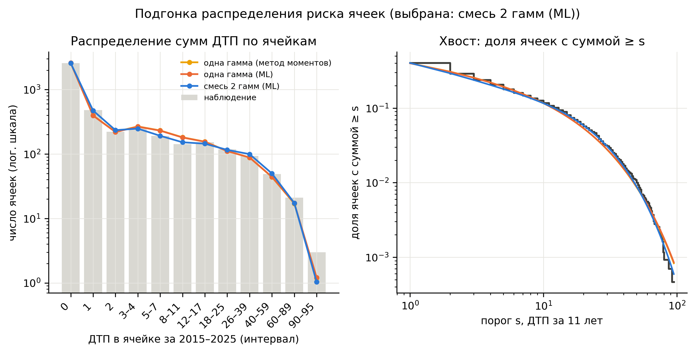
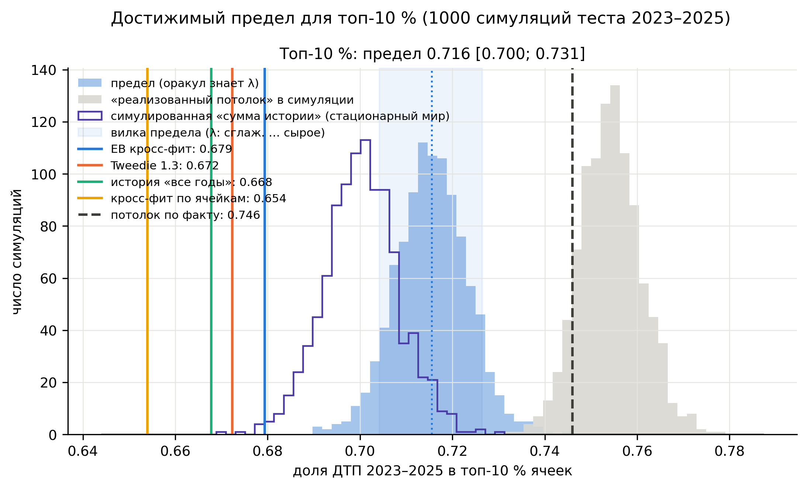
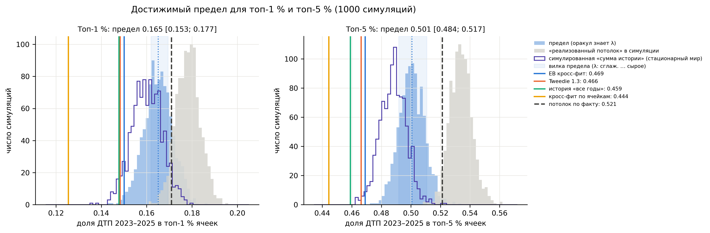
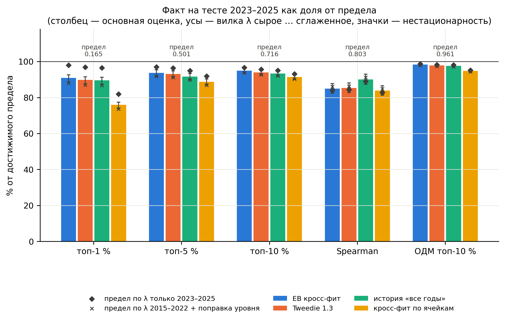

# Этап 7, шаг D: достижимый предел предсказуемости (симуляция оракула)

Журнал — [LOG.md](LOG.md). Скрипт — `scripts/stage7D_noise_ceiling.py` (сид 20261026, 1000 симуляций, ≈ 6 мин):
`PYTHONPATH=src venv/bin/python scripts/stage7D_noise_ceiling.py [--nsim 1000] [--plots-only]`.
Модели не обучались. Факт вариантов взят из `../history_eb/` (`eb_top1_5_10.csv`, `metrics_summary.csv`,
`odm_recall_pooled.csv`), метрики считаются функциями модуля `v2_eval_year` (`vy.coverages`, связи честно).

## Вопрос

«Потолок» в прошлых отчётах (ранжирование по факту 2023–2025: 0.171 / 0.521 / 0.746 в топ-1/5/10 %) знает
не только, какие ячейки опасны, но и **случайность** конкретных лет: в какой ячейке ДТП случайно
произошло, а в какой нет. Такого не знает ни один прогноз. Честный предел — **оракул**, который знает
истинный уровень риска каждой ячейки λ_i (ДТП в год), но не знает исхода. Сколько ДТП накрыл бы он?

## Метод простым языком

1. **Истинный риск ячейки.** Риск ячеек по городу описан гамма-распределением (или смесью гамм).
   Число ДТП ячейки за год при известном риске — пуассоновское (внутри ячейки φ = 1.08, т. е. почти
   Пуассон; см. `descriptive/`). Тогда сумма ячейки за 11 лет — отрицательно-биномиальная, параметры гаммы
   подгоняются максимальным правдоподобием по 4 296 ячейкам. Для каждой ячейки по её сумме S_i за n лет
   получается апостериор: смесь Gamma(α_j + S_i, β_j + n) с весами компонент.
   Три оценки λ_i:
   - **основная** — в каждой симуляции λ_i **сэмплируется** из апостериора (учтена неопределённость
     оценки риска ячейки);
   - **граница сверху** — сырое среднее S_i / n (переоценивает разброс между ячейками: шум прошлых лет
     принимается за риск);
   - **граница снизу** — апостериорное среднее (сглажено к среднему, недооценивает разброс).
2. **Симуляция теста.** Для каждой ячейки и каждого года 2023–2025 ДТП генерируются по видам: Poisson(λ_i·p_ik),
   доли видов p_i ~ Dirichlet(счёты видов ячейки + 5·доли города); сумма по видам — Poisson(λ_i), за три
   года — Poisson(3λ_i). Проверка: внутриячеечная сверхдисперсия φ = 1.08 (множитель Gamma(53, 53) на
   ячейко-год). 1000 повторов.
3. **Оракул** ранжирует ячейки по тому λ, из которого сгенерированы Y, и получает: долю накрытых ДТП в
   топ-1/5/10 % (`vy.coverages`), Spearman, recall очагов ОДМ (**полный критерий** «≥ 3 ДТП одного вида
   (без other) или ≥ 5 любых» по каждому симулированному году, объединение по трём годам — как
   `odm_recall_from_preds`). Тут же — «реализованный потолок» (ранжирование по самим Y) и **проверка мира
   модели**: в той же симуляции генерируется 8 лет «истории» и считается честный ориентир «сумма истории».
4. **Spearman — отдельная оговорка.** У Y 74 % нулей (сумма за 3 года), это связи. Строгий порядок по λ
   раздаёт ячейкам почти без риска разные ранги при одинаковом Y = 0 и **не максимизирует** Spearman: в
   симуляции ориентир «сумма истории» (у него те же связи-нули) получает 0.738 > 0.713 у строгого оракула.
   Поэтому предел Spearman — лучший из двух оракулов: строгий порядок λ и «оракул с формой Y» (ранги λ
   переносятся на отсортированную независимую копию Y — те же связи, порядок по λ): 0.803. Огрубление λ
   до 5–200 квантильных групп не помогает (≤ 0.713).

## 1. Подгонка распределения риска (рис. 1, `gamma_fit.csv`)

| модель | параметры | logL | BIC | доля нулей | ≥ 30 ДТП за 11 лет | ≥ 60 |
|---|---|---|---|---|---|---|
| наблюдение | — | — | — | 0.598 | 0.031 | 0.0056 |
| одна гамма, метод моментов | α = 0.161, β = 0.477 | −8056.6 | — | 0.600 | 0.028 | 0.0050 |
| одна гамма, ML | α = 0.159, β = 0.472 | −8056.6 | 16 130 | 0.602 | 0.028 | 0.0051 |
| **смесь 2 гамм, ML (выбрана)** | 73 %: α = 0.23, ср. 0.044 ДТП/год; 27 %: α = 0.74, ср. 1.15 | −8040.2 | **16 122** | 0.598 | 0.031 | 0.0048 |
| смесь 3 гамм | третья компонента 0.9 %, ср. 5.3 | −8038.7 | 16 144 | 0.598 | 0.030 | 0.0054 |
| гамма + «нулевой риск» | вес нуля → 0 | −8056.6 | 16 138 | 0.602 | 0.028 | 0.0051 |

Одна гамма уже хорошо описывает и нули, и хвост; смесь двух гамм чуть лучше по BIC (−8) и в хвосте
≥ 30 ДТП (3.1 % против 2.8 %), её и берём. «Ячеек с нулевым риском» данные не требуют. Предел почти не
зависит от выбора: одна гамма даёт 0.166 / 0.501 / 0.712 против 0.165 / 0.501 / 0.716.

## 2. Достижимый предел на тесте 2023–2025 (`ceiling_scenarios.csv`)

λ по всем 11 годам, Y ~ Poisson(3λ), среднее [95 % интервал по 1000 симуляций]; вилка — границы снизу/сверху.

| метрика | предел (основная) | вилка (сглаж. … сырое) | φ = 1.08 | «реализованный потолок» в симуляции | потолок по факту |
|---|---|---|---|---|---|
| топ-1 % | **0.165** [0.153; 0.177] | 0.162 … 0.169 | 0.165 | 0.178 | 0.171 |
| топ-5 % | **0.501** [0.484; 0.517] | 0.492 … 0.511 | 0.501 | 0.534 | 0.521 |
| топ-10 % | **0.716** [0.700; 0.731] | 0.704 … 0.726 | 0.715 | 0.754 [0.741; 0.767] | 0.746 |
| Spearman (строгий / «с формой Y») | 0.713 / **0.803** [0.787; 0.820] | 0.777 … 0.828 | 0.712 / 0.802 | — | — |
| ОДМ топ-1 % | **0.310** [0.278; 0.343] | 0.316 … 0.320 | 0.306 | 0.415 | 0.536 |
| ОДМ топ-5 % | **0.814** [0.772; 0.859] | 0.827 … 0.828 | 0.810 | 1.0 | 1.0 |
| ОДМ топ-10 % | **0.961** [0.937; 0.981] | 0.966 | 0.960 | 1.0 | 1.0 |

Внутриячеечная сверхдисперсия φ = 1.08 на предел не влияет (≤ 0.001). Наблюдаемый потолок по факту (0.746)
лежит внутри распределения «реализованного потолка» симуляции [0.741; 0.767] — мир модели правдоподобен.

## 3. Нестационарность

| откуда λ | поправка уровня | топ-1 / 5 / 10 % | Spearman («с формой Y») | ОДМ 1 / 5 / 10 % | реализ. потолок топ-10 % | «история» в симуляции, топ-10 % |
|---|---|---|---|---|---|---|
| 2015–2025 (основная) | нет | 0.165 / 0.501 / 0.716 | 0.803 | 0.31 / 0.81 / 0.96 | 0.754 | 0.700 |
| 2015–2025 | да (0.96 / 0.90 / 0.89) | 0.166 / 0.501 / 0.715 | 0.796 | 0.33 / 0.83 / 0.96 | 0.757 | 0.700 |
| (а) 2015–2022 | да (0.93 / 0.87 / 0.87) | 0.170 / 0.511 / 0.725 | 0.794 | 0.33 / 0.83 / 0.97 | 0.766 [0.752; 0.779] | 0.710 |
| (б) 2015–2022 | нет | 0.170 / 0.511 / 0.725 | 0.801 | 0.30 / 0.82 / 0.96 | 0.762 | 0.710 |
| (в) только 2023–2025 | нет | 0.153 / 0.484 / 0.703 | 0.812 | 0.31 / 0.81 / 0.96 | **0.746** [0.731; 0.761] | 0.686 |

- Поправка уровня (2024–25 ≈ 0.87 от 2015–22) почти не меняет долю накрытых ДТП (≤ 0.001): ранжирование не
  зависит от общего множителя, а лишний шум от меньшего числа ДТП мал. Уровень заметен только для ОДМ
  (очагов больше при большем числе ДТП): ОДМ топ-1 % 0.31 → 0.33.
- Важнее, **какие годы** задают риск: риск 2015–2022 был сосредоточен сильнее (var/mean 3.0–3.8 против 2.8
  в 2023–25), предел по нему 0.725, по самим тестовым годам — 0.703. Вилка предела топ-10 % с учётом
  нестационарности — **0.70–0.73**, топ-1 % — 0.153–0.170, топ-5 % — 0.48–0.51.
- Мир по 2015–2022 переоценивает концентрацию теста: его «реализованный потолок» 0.766 [0.752; 0.779], а
  факт 0.746 — вне интервала. Мир по 2023–2025 воспроизводит факт точно (0.169 / 0.522 / 0.746 против
  0.171 / 0.521 / 0.746). Мир по всем годам — посередине (0.754, факт внутри).
- **Апостериорная проверка «историей».** В стационарном симулированном мире честный ориентир «сумма 8 лет
  истории» накрывает 0.700 [0.685; 0.717] — 98 % предела. На факте у истории «все годы» 0.668. Разница
  ≈ 3 п.п. — цена нестационарности: риск ячеек меняется со временем (новые кварталы, перестроенные
  развязки; см. выбросы в `history_eb/`), а стационарная модель этого не содержит.

## 4. Самопроверка на фолдах 2021 и 2022 (`fold_selfcheck.csv`)

Фолд — один год; λ по годам до фолда (с поправкой уровня и без) и по всем годам.

| фолд | предел топ-1 / 5 / 10 % (λ до фолда, поправка) | вилка топ-10 % (все сценарии) | лучший факт моделей топ-1 / 5 / 10 % | Spearman: предел / лучший факт | реализ. потолок: симуляция / факт |
|---|---|---|---|---|---|
| 2021 | 0.175 / 0.518 / 0.732 | 0.704 … 0.750 | 0.158 / 0.497 / 0.694 | 0.719 / 0.611 (история) | 0.826 / 0.832 |
| 2022 | 0.173 / 0.515 / 0.729 | 0.704 … 0.744 | 0.147 / 0.481 / 0.692 | 0.710 / 0.593 (история) | 0.827 / 0.822 |

- Предел выше лучшего факта во всех 15 из 16 сценариев (по долям ДТП и Spearman «с формой Y»). Исключение —
  нижняя граница (апостериорное среднее по всем годам) на фолде 2021, топ-5 %: 0.491 < 0.497 у Tweedie —
  в пределах интервала симуляции [0.465; 0.520]; нижняя граница и должна быть заниженной.
- **Что было не так и исправлено:** строгий оракул по Spearman (0.573) ниже истории на факте (0.611) — см.
  оговорку о связях выше; с оракулом «с формой Y» (0.719) проверка проходит.
- На фолдах модели на 94–96 % предела топ-5/10 % — как на тесте; самопроверка метод подтверждает.

## 5. Сравнение вариантов (`comparison.csv`, рис. 4)

Доля от предела = факт / предел (основная оценка); в скобках — по вилке «сглаж. … сырое»; затем — по пределу
из тестовых лет (в) и из 2015–2022 с поправкой (а); последняя колонка — доля от потолка по факту.

| вариант | метрика | факт | % предела (вилка) | (в) / (а) | % потолка по факту |
|---|---|---|---|---|---|
| EB кросс-фит | топ-1 % | 0.150 | **91** (89–93) | 98 / 88 | 88 |
| | топ-5 % | 0.469 | **94** (92–95) | 97 / 92 | 90 |
| | топ-10 % | 0.679 | **95** (94–97) | 97 / 94 | 91 |
| | Spearman | 0.682 | **85** (82–88) | 84 / 86 | — |
| | ОДМ 1 / 5 / 10 % | 0.30 / 0.79 / 0.94 | **97 / 97 / 98** | 96 / 98 / 99 · 91 / 95 / 98 | 56 / 79 / 94 |
| Tweedie 1.3 | топ-1 % | 0.148 | **90** (88–92) | 97 / 87 | 87 |
| | топ-5 % | 0.466 | **93** (91–95) | 96 / 91 | 89 |
| | топ-10 % | 0.672 | **94** (93–96) | 96 / 93 | 90 |
| | Spearman | 0.685 | **85** (83–88) | 84 / 86 | — |
| | ОДМ 1 / 5 / 10 % | 0.30 / 0.80 / 0.94 | **96 / 98 / 98** | 95 / 99 / 98 · 90 / 96 / 97 | 56 / 80 / 94 |
| история «все годы» | топ-1 % | 0.148 | **90** (87–91) | 96 / 87 | 86 |
| | топ-5 % | 0.459 | **92** (90–93) | 95 / 90 | 88 |
| | топ-10 % | 0.668 | **93** (92–95) | 95 / 92 | 90 |
| | Spearman | 0.723 | **90** (87–93) | 89 / 91 | — |
| | ОДМ 1 / 5 / 10 % | 0.30 / 0.78 / 0.94 | **97 / 96 / 98** | 96 / 97 / 98 · 90 / 94 / 97 | 56 / 78 / 94 |
| кросс-фит по ячейкам | топ-1 % | 0.125 | **76** (74–77) | 82 / 74 | 73 |
| | топ-5 % | 0.444 | **89** (87–90) | 92 / 87 | 85 |
| | топ-10 % | 0.654 | **91** (90–93) | 93 / 90 | 88 |
| | Spearman | 0.673 | **84** (81–87) | 83 / 85 | — |
| | ОДМ 1 / 5 / 10 % | 0.25 / 0.75 / 0.91 | **81 / 92 / 95** | 80 / 93 / 95 · 76 / 90 / 94 | 47 / 75 / 91 |

**Куда уходит разрыв до потолка по факту (топ-10 %, EB):** 0.746 − 0.679 = 0.067. Из них 0.030 (45 %) —
знание случайности (потолок по факту − предел 0.716), ещё 0.037 — разрыв до предела. С пределом по тестовым
годам (0.703) на случайность приходится 0.043 (64 %), на разрыв — 0.024. В топ-1 % на случайность приходится
меньше (0.171 − 0.165 = 0.006 из 0.021): верх списка — устойчивые очаги. «Реализованный потолок» в
симуляции (0.754) на 0.038 выше предела во всех мирах: это та часть «потолка», которую никто не достигнет.

## Вывод

Честный предел предсказуемости для доли ДТП 2023–2025 в верхних 1 / 5 / 10 % ячеек — **0.165 / 0.501 / 0.716**
(вилка по оценке риска 0.162–0.169 / 0.492–0.511 / 0.704–0.726, с учётом нестационарности 0.153–0.170 /
0.48–0.51 / 0.70–0.73), а не 0.171 / 0.521 / 0.746, как у «потолка по факту». Лучшие варианты (EB кросс-фит,
Tweedie 1.3, история «все годы») находятся на **90–91 % предела в топ-1 %, 92–94 % в топ-5 % и 93–95 % в
топ-10 %**, а по очагам ОДМ — на 96–98 %; честная структура без истории (кросс-фит) — на 76 / 89 / 91 %.
Остаток до предела (≈ 3–4 п.п. в топ-10 %) почти целиком объясняется нестационарностью: в стационарном
симулированном мире даже простая «сумма истории» берёт 98 % предела, а на факте — 93 %. Значит, улучшить
ранжирование заметно можно только предсказывая **изменения** риска ячеек (новая застройка, перестройка
узлов), а не уточняя статичные признаки; запас при этом — единицы процентных пунктов. Половина и более
разрыва до «потолка по факту» — случайность конкретных лет, недостижимая ни для какой модели.

## Ограничения

- Риск ячейки считается постоянным в окне оценки; нестационарность проверена только сменой окна (вся
  история / до теста / тест), модели тренда риска отдельных ячеек нет.
- Предел относится к ранжированию по риску ячейки «в среднем». Spearman не максимизируется строгим порядком
  при связях; предел Spearman — по «оракулу с формой Y», это эвристика, а не строгая граница.
- ОДМ: в симуляции очагов больше, чем на факте (304 против 235 за три года в основном сценарии; 260–263 при
  совпадении уровня) — виды ДТП в ячейке сгенерированы независимыми Пуассонами с долями из сглаженных
  наблюдаемых; предел для ОДМ зависит от общего уровня ДТП и менее надёжен, чем для доли ДТП.
- Граница сверху для окна 2023–2025 вырождена (сырое среднее = сам факт → предел = потолок по факту 0.746),
  поэтому для (в) используется только основная оценка.
- Перекрёстные связи между ячейками (соседство, общие магистрали) не моделировались: ячейки независимы.

## Файлы

`gamma_fit.csv`, `chosen_model.txt`, `ceiling_scenarios.csv` (все сценарии, среднее и 95 % интервалы),
`sim_draws_test.parquet` (симуляции теста), `observed_realized_ceiling.csv`, `variants_fact.csv`,
`comparison.csv`, `fold_selfcheck.csv`, `run.log`; рисунки и CSV к ним — `figures/`; копия рис. 2 —
`../../summary/stage7_noise_ceiling.png`.
