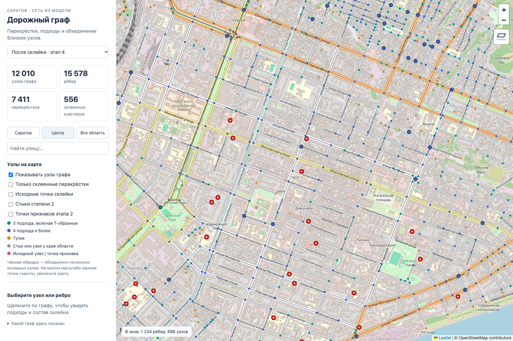
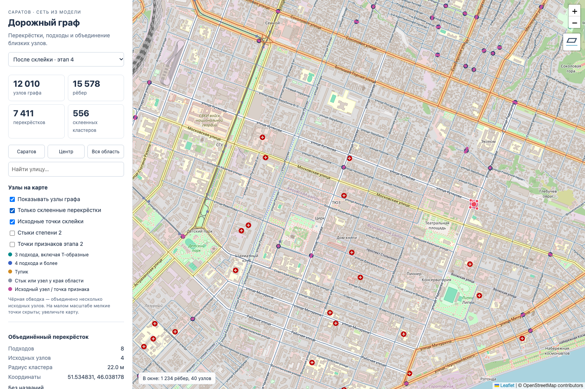

# Интерактивная карта сохранённого графа модели: Саратов

По запросу пользователя показана сеть этапа 4 после консолидации узлов,
а не новый граф, построенный из исходной выгрузки. HTML находится в
`~/Downloads/Граф_дорог_Саратова_из_модели/Карта_графа_Саратова.html`.
Рядом сохранены описание и параметры графа.

## Источники и соответствие модели

Основной слой непосредственно читает
`parquet_output/osm_street_graph_consolidated_nodes.parquet` и
`parquet_output/osm_street_graph_consolidated_edges.parquet`.
Режим до склейки читает `osm_street_graph_nodes.parquet` и
`osm_street_graph_edges.parquet`. Новые топология, степень или
геометрия не строятся: используются сохранённые значения.
Исходные узлы каждого объединения берутся из `raw_node_ids`.
Сохранённая геометрия рёбер уже содержит соединения с центроидами кластеров.

| Показатель | До склейки | После склейки |
|---|---:|---:|
| Узлы графа | 12 703 | 12 010 |
| Рёбра | 16 311 | 15 578 |
| Перекрёстки, степень ≥ 3 | 8 102 | 7 411 |
| 3 подхода | 6 456 | 5 347 |
| 4 и более подходов | 1 646 | 2 064 |
| Тупики | 2 544 | 2 544 |
| Стыки степени 2 | 2 057 | 2 055 |
| Узлы у края выгрузки | 97 | 97 |
| Объединённые кластеры | — | 556 |

На [этапе 2](../features/stage2_junctions/README.md) число подходов
заменило число OSM-ways: Т-образные пересечения стали считаться корректно.
На [этапе 4](../features/stage4_geometry/README.md) объединены близкие
связанные узлы: радиус 20 м, путь по улицам ≤ 40 м, отдельное правило
колец длиной ≤ 400 м. Это два разных преобразования.

Признаки числа 3-/4-сторонних перекрёстков вычисляются по точкам этапа 2,
а консолидированный граф применяется в геометрических признаках.
Чтобы не смешивать эти количества, карта содержит отдельный слой
«Точки признаков этапа 2» из `osm_junction_v2_nodes.parquet`.
Множество этих 8 102 точек поэлементно совпадает с перекрёстками сырого графа.

Уличная сеть не включает `service`, как в сохранённом графе этапа 4.
Область — прежнее саратовское окно модели, с частью Энгельса и граничными
дорогами, а не муниципальный полигон из межгородской проверки.

## Возможности карты

- Переключение между графом до и после склейки.
- Фильтр объединённых узлов, показ исходных точек и соединений.
- Цвета 3-сторонних, 4+ перекрёстков, тупиков и стыков; граничные узлы отдельно.
- Щелчок на узле: степень, входящие рёбра, названия улиц, состав и радиус кластера.
- Щелчок на ребре: длина, класс, направление и исходный OSM-way.
- Поиск улиц, переход к центру и переключение подложки «OpenStreetMap / Только граф».

Геометрия и Leaflet встроены в один HTML (около 9.8 МБ). Сам граф работает
без интернета; тайловая подложка требует подключения. На мелком масштабе
часть точек скрыта для читаемости, полные количества показаны в панели.

## Проверки и воспроизведение

Скрипт: [export_saratov_model_graph_map.py](../../../scripts/export_saratov_model_graph_map.py).
Шаблон: [saratov_model_graph_map.html](../../../scripts/saratov_model_graph_map.html).

```sh
venv/bin/python scripts/export_saratov_model_graph_map.py
```

Проверены уникальность узлов/рёбер, все ссылки концов рёбер на узлы,
совпадение степеней с числом концов рёбер, совпадение координат концов
с узлами и отсутствие service. Контрольные суммы исходных файлов
сохранены в [statistics.json](statistics.json).

Headless Chrome проверил загрузку HTML с диска, выбор узла реальным щелчком,
подсветку подходов, исходные точки, фильтр склеек, переключение до/после,
поиск улицы, слой этапа 2 и режим без подложки. Ошибок JavaScript нет.
Ответы тайлов OpenStreetMap — HTTP 200; отменённые запросы в журнале
проверки относятся к переключениям вида и намеренному отключению подложки.
Изначально выбранная подложка CARTO показала заглушку API key и была
заменена до выдачи результата.

Результаты: [browser_checks.json](browser_checks.json).
Внешний вид центра и выбранного объединения визуально проверены:




