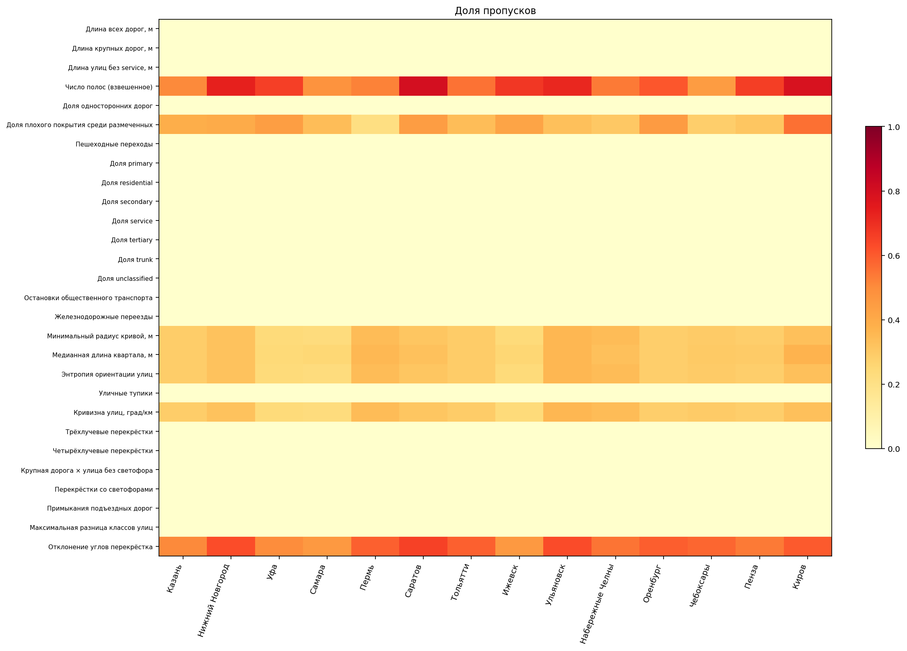
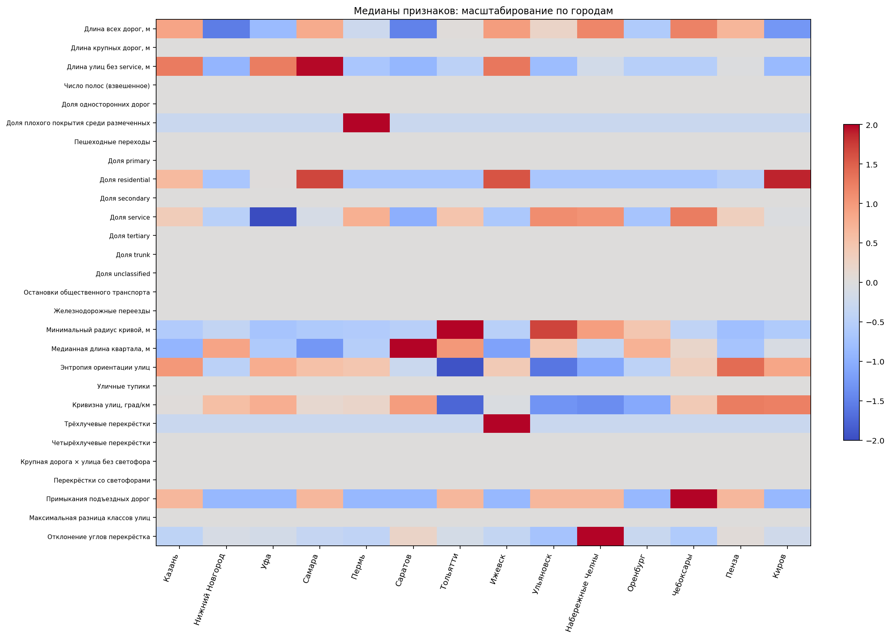
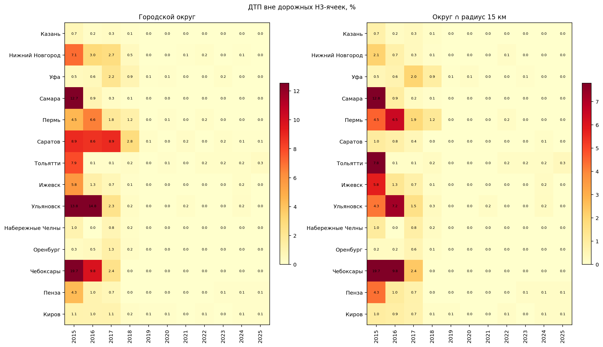
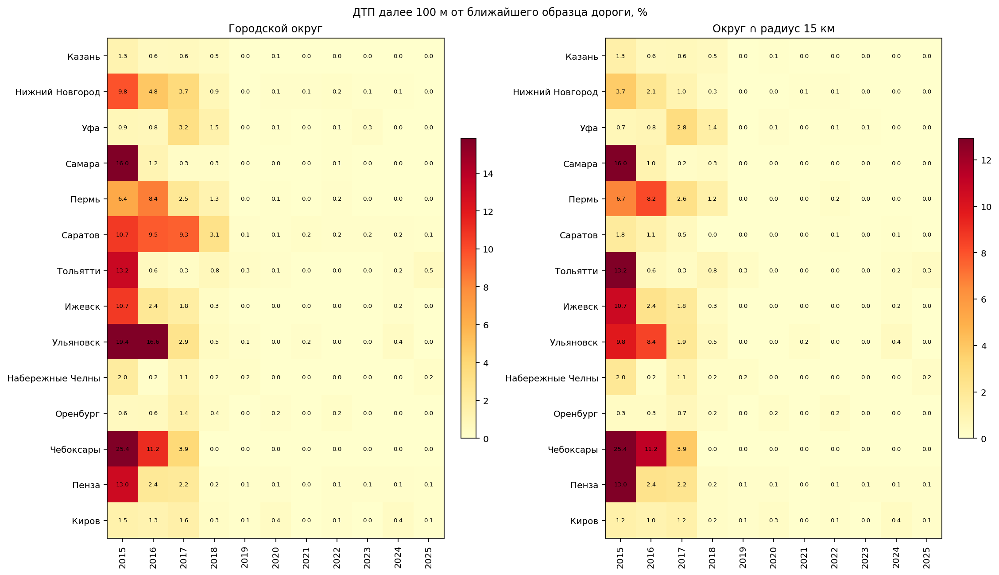
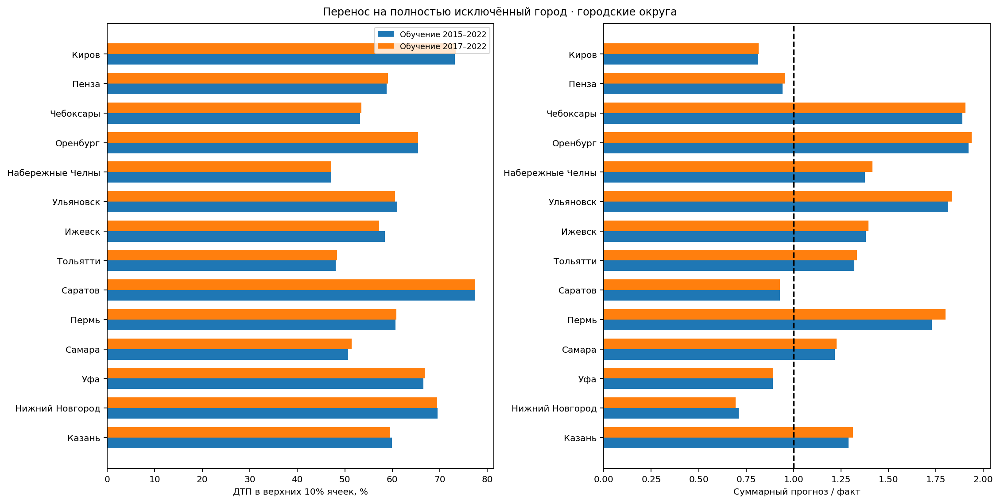
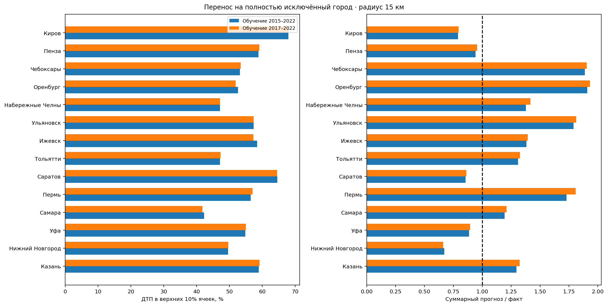
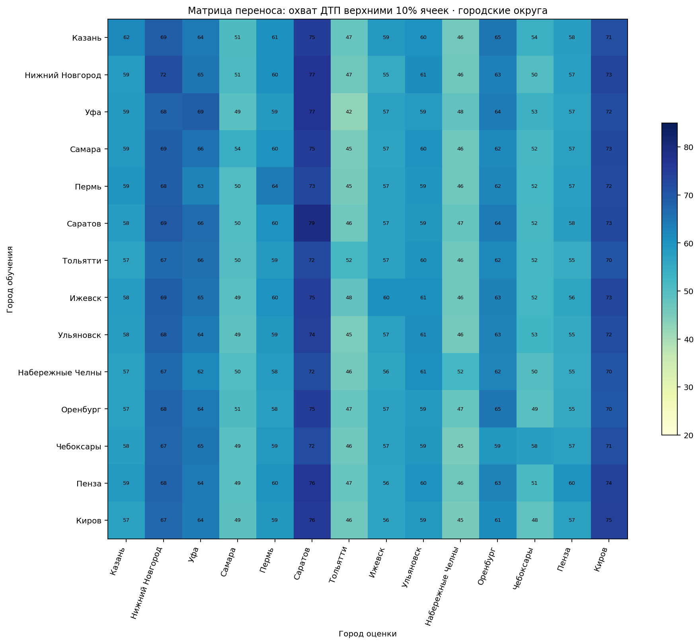
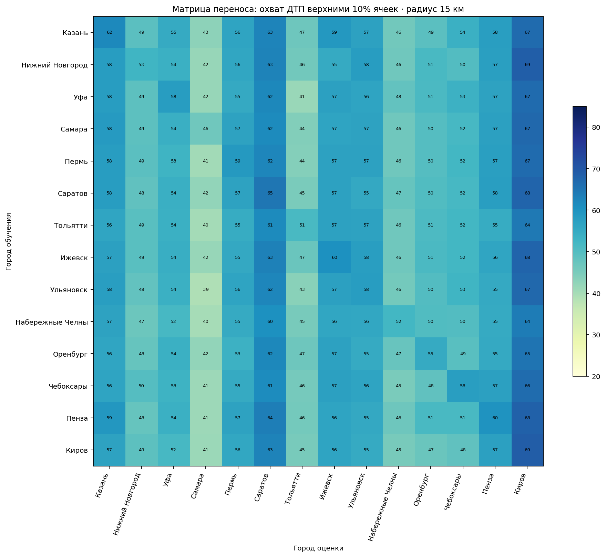
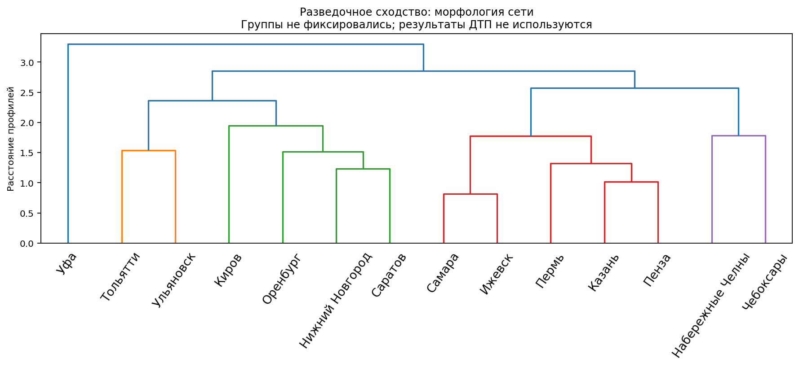
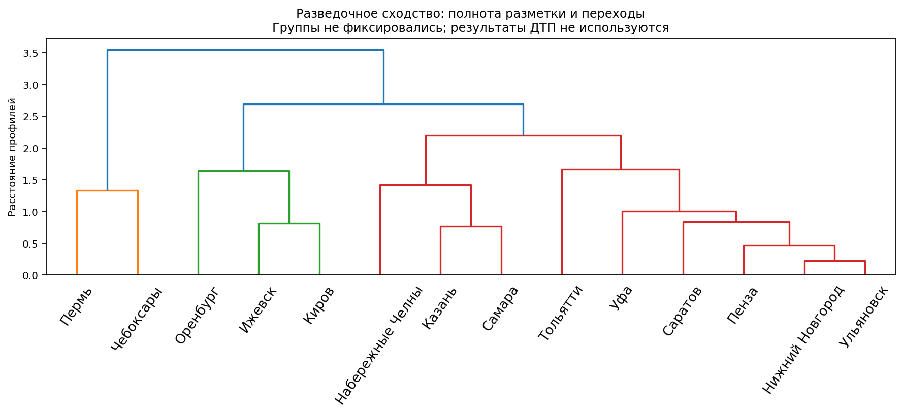

# 14 городов Поволжья: признаки, качество координат и перенос модели

Дата: 2026-11-06. Продолжение проверки гипотезы о проблемных координатах ДТП 2015–2016 годов.
Основные результаты ниже относятся к новым единым территориям; они не заменяют числа прежних bbox-экспериментов.

## 1. Краткий результат

- Признаки извлечены для всех 14 городов из локального PBF от 2026-06-03; для каждого использована граница
  городского округа из этого же снимка и буфер 3 км для построения сети. Городской округ может включать
  сельские территории, поэтому отдельно оценена подвыборка «округ ∩ радиус 15 км от OSM-центра».
- В когортах 154,611 ДТП за 2015–2025. На 2015–2016 приходится 19.1% событий,
  но 73.0% всех событий вне дорожных ячеек (1216 из 1665).
  Ранние координаты объективно хуже по соответствию современной сети во многих, но не одинаково во всех городах.
- Среднее изменение охвата10 при исключении ранних лет из обучения на других городах:
  +0.02 п.п. по округам, -0.05 п.п. в радиусе 15 км.
  По округам положительный знак в 7/14 городов; нижняя граница парного пространственного ДИ
  выше нуля в 0/14. Это разведочный анализ, без поправки на множество городов/метрик.
- Наличие ошибок раннего периода и польза удаления годов для метрики — разные утверждения.
  Вывод о глобальном удалении должен опираться на обе части анализа и учитывать потерю числа наблюдений.
- Типология населённых пунктов здесь не фиксируется. Получены измеримые профили морфологии и качества карты,
  матрицы переноса и разведочные деревья сходства; результаты ДТП не включались в профили группировки.

## 2. Протокол и география

Города отобраны по населению >350 тыс. (2025) из фактически скачанного OSM Поволжья:
Казань, Нижний Новгород, Уфа, Самара, Пермь, Саратов, Тольятти, Ижевск, Ульяновск,
Набережные Челны, Оренбург, Чебоксары, Пенза, Киров.
Инвентарь — `reports/city_inventory/cities_over_350k.csv`.

Граница каждого округа собрана из OSM relation (`cities.json`, `boundaries.geojson` в исходных артефактах).
**Это современные муниципальные границы, а не границы городской застройки и не исторические границы.**
В Саратове площадь округа превышает 2500 км²; части Самары, Нижнего Новгорода и Оренбурга тоже
сильно удалены от центральной точки. Население в инвентаре относится к городу и служит только
отбору городов; оно не используется для вычисления плотности населения в муниципальном полигоне.

Когорта задаётся центром H3-ячейки res 9 внутри муниципального полигона. Для обучения берутся только ячейки
с автомобильными дорогами. Все ДТП, попавшие в такую ячейку, входят в её счёт, даже если точка
непосредственно за границей полигона. В `coordinate_audit.csv` отдельно посчитаны такие пограничные случаи.
Центры когорт 14 округов не пересекаются. Границы не выбирались по результатам ДТП.

Подвыборка 15 км — чувствительность результата к периферии; модель на ней не переобучается.
Для аудита используется расстояние точки, для модельных ячеек — расстояние центроида до центрального узла OSM;
расхождение возможно в узкой полосе на границе круга. Радиус не гарантирует полного охвата города.

| Город | Площадь округа, км² | Дорожных ячеек | ДТП теста | Пустых ячеек теста, % | Охват10 по факту, % | Нет полосности, % |
| --- | --- | --- | --- | --- | --- | --- |
| Казань | 639.25 | 3635.00 | 3888.00 | 70.23 | 69.34 | 50.54 |
| Нижний Новгород | 1734.67 | 6657.00 | 6634.00 | 75.03 | 77.81 | 73.41 |
| Уфа | 713.84 | 3524.00 | 3387.00 | 73.86 | 74.64 | 65.89 |
| Самара | 541.81 | 2610.00 | 3546.00 | 64.33 | 61.53 | 47.93 |
| Пермь | 801.32 | 3717.00 | 2372.00 | 76.27 | 72.93 | 52.11 |
| Саратов | 2562.40 | 5858.00 | 3427.00 | 82.50 | 87.16 | 79.94 |
| Тольятти | 289.98 | 1766.00 | 1839.00 | 65.74 | 61.28 | 55.27 |
| Ижевск | 318.25 | 1834.00 | 1708.00 | 71.48 | 68.97 | 67.67 |
| Ульяновск | 656.37 | 2732.00 | 1585.00 | 76.87 | 73.38 | 71.85 |
| Набережные Челны | 171.00 | 1256.00 | 1410.00 | 65.21 | 60.92 | 53.74 |
| Оренбург | 1000.56 | 2536.00 | 1165.00 | 80.88 | 78.88 | 60.61 |
| Чебоксары | 252.71 | 1266.00 | 969.00 | 71.88 | 67.29 | 44.71 |
| Пенза | 302.31 | 1915.00 | 2287.00 | 67.62 | 66.94 | 66.16 |
| Киров | 765.35 | 2957.00 | 2434.00 | 78.56 | 82.29 | 78.90 |

## 3. Как извлечены признаки и что проверено

Единый набор 28 OSM-признаков этапа 4: длины и классы дорог, полосность, покрытие, переходы и остановки,
перекрёстки, примыкания, геометрия и кварталы. СКДФ, история ДТП, координаты и население не подаются в модель.
Для каждого города выбрана местная зона UTM, граничные признаки графа определяются по его собственной
области извлечения. Геометрия дорог с буфером строится целиком, признаки выбираются затем по центроидам.

Проверено: уникальность H3, ненулевая дорожная длина, отсутствие бесконечностей, наличие всех 28 признаков,
сумма долей дорожных классов = 1, согласованность уличной длины между тэговым и геометрическим расчётом
(max расхождения <0.001 м). Протокол проверки — `reports/multicity_350k/feature_validation.csv`.
Суммы годовых таргетов сверены с исходными ДТП, попавшими в дорожную когорту.

Полные распределения: `feature_descriptive.csv` (14×28), попарные сдвиги: `pairwise_feature_shift.csv`
(91 пара ×28), маргинальные Spearman с фактом теста: `feature_associations.csv`.
KS используется как размер различия, без независимых p-value по соседним ячейкам.
Wasserstein нормирован на объединённое стандартное отклонение двух выборок; пропуски сравниваются отдельно.




ECDF всех 28 признаков: [1](figures/ecdf_1.png), [2](figures/ecdf_2.png),
[3](figures/ecdf_3.png), [4](figures/ecdf_4.png). NaN исключены, нули сохранены, X — symlog.
Полнота полосности/покрытия и нанесение переходов могут отражать как реальную инфраструктуру,
так и работу картографов: отделить эти причины по OSM автоматически нельзя.

## 4. ДТП вне сети: проверка ранних годов

| Город | Вне ячеек 2015–16, % | Вне ячеек 2017–25, % | Далее 100 м, 2015–16, % | Далее 100 м, 2017–25, % | Доля ранних среди исключённых, % |
| --- | --- | --- | --- | --- | --- |
| Казань | 0.44 | 0.06 | 0.89 | 0.15 | 66.67 |
| Нижний Новгород | 4.39 | 0.39 | 6.54 | 0.58 | 60.70 |
| Уфа | 0.56 | 0.40 | 0.84 | 0.60 | 27.40 |
| Самара | 6.41 | 0.04 | 8.10 | 0.07 | 97.08 |
| Пермь | 5.50 | 0.53 | 7.36 | 0.65 | 80.49 |
| Саратов | 8.77 | 1.46 | 10.11 | 1.59 | 62.04 |
| Тольятти | 3.84 | 0.14 | 6.63 | 0.27 | 87.32 |
| Ижевск | 2.84 | 0.12 | 5.31 | 0.30 | 82.61 |
| Ульяновск | 14.28 | 0.39 | 18.06 | 0.54 | 91.05 |
| Набережные Челны | 0.46 | 0.10 | 1.02 | 0.17 | 55.56 |
| Оренбург | 0.44 | 0.27 | 0.61 | 0.35 | 36.36 |
| Чебоксары | 12.60 | 0.29 | 15.16 | 0.47 | 85.33 |
| Пенза | 2.42 | 0.13 | 6.90 | 0.38 | 78.57 |
| Киров | 1.04 | 0.21 | 1.38 | 0.33 | 50.00 |




Расстояние считается до ближайшего образца полилинии автомобильной дороги из того же снимка OSM.
Шаг образцов не более 20 м, исходные вершины сохранены. Это верхняя аппроксимация расстояния до
полилинии, ошибка дискретизации примерно до 10 м (плюс небольшая проекционная погрешность).
Поэтому отдельные события около порога 100 м нельзя строго классифицировать. Разница долей
порядка нескольких/десятков процентов гораздо больше этого источника погрешности.
Включены все автомобильные классы, в том числе service; лесные тропы и track этим определением могут исключаться.

Крупный ранний сдвиг виден у Ульяновска, Чебоксар, Самары, Перми, Тольятти, Нижнего Новгорода и Пензы.
Но Уфа и Оренбург отличаются слабее. В Пензе обе координаты лежат на сетке 0.001° у примерно 44.5%
ранних событий и 10.0% поздних — независимый признак грубого округления. Само округление не устанавливает
точную ошибку события: часть округлённых координат всё ещё попадает в корректную ячейку.

У Саратова доля исключённых ранних событий в полном округе 8.77%,
а в радиусе 15 км — 0.91%. Для Нижнего Новгорода —
4.39% против 1.18%.
Это показывает сильное влияние периферии и границ. Нельзя объяснять все исключения ошибочными координатами:
часть может относиться к изменившимся дорогам, неполноте OSM и реальным событиям вне нанесённой сети.
Ручная проверка пользователя по Саратову поддерживает ошибку координат для просмотренных им точек,
но не заменяет проверку каждого нового города.

## 5. Эксперимент исключения 2015–2016

Основная модель: CatBoost Tweedie 1.3, 800/0.05/6, без подбора параметров; годовая панель с неперекрывающимися
годами. Для каждого города обучение на остальных 13 — **leave-one-city-out**, без местной истории.
Тест — 2023–2025; прогноз сделан по обучению до 2023. Два основных окна:
- 2015–2022 (8 лет);
- 2017–2022 (6 лет).

Видимые ДТП вне дорожных ячеек не входят положительными примерами в обучение ни одного варианта:
так устроена исходная дорожная панель. Их истинные места остаются неизвестными, поэтому ошибки могут
приводить к недосчёту событий на настоящих дорогах. Сравнение окон оценивает общий эффект периода,
включая скрытые ошибки, попавшие на другую дорогу, давность и потерю наблюдений; оно не является
экспериментом исправления координат.

Для обоих окон одинаковы признаки, тестовые события и сиды 42/7/123. P99-клиппинг считается только
по обучающим городам/годам своего варианта. Целевой город не участвует ни в fit, ни в вычислении порогов.
Дополнительный контроль с сидом 42: исключить 2017–2018, сохранив 2015–2016 и 2019–2022 — те же шесть лет.
Он помогает оценить специфичность раннего периода, но не полностью отделяет качество координат от
давности сети/событий и изменения общего уровня аварийности.

Основная таблица — средние метрик трёх сидов; ДИ — для разности метрик усреднённых прогнозов этих сидов,
500 парных пересэмплирований пространственных блоков H3 res 7 внутри целевого города. Поэтому центр
ДИ и разность средних сидовых метрик могут немного отличаться. Сидовая вариабельность не исчерпывает
неопределённость по городам, а пространственный bootstrap не учитывает ошибки источников.

### Полные городские округа

| Город | 2015+, охват10 % | 2017+, охват10 % | Δ, п.п. | ДИ Δ ансамбля, ниж. | ДИ Δ ансамбля, верх. | Прогноз/факт 2015+ | Прогноз/факт 2017+ |
| --- | --- | --- | --- | --- | --- | --- | --- |
| Казань | 59.95 | 59.59 | -0.36 | -1.06 | 1.19 | 1.29 | 1.31 |
| Нижний Новгород | 69.50 | 69.42 | -0.08 | -0.55 | 0.68 | 0.71 | 0.69 |
| Уфа | 66.51 | 66.79 | 0.29 | -0.91 | 0.88 | 0.89 | 0.89 |
| Самара | 50.72 | 51.43 | 0.71 | -0.98 | 1.82 | 1.22 | 1.23 |
| Пермь | 60.62 | 60.85 | 0.22 | -0.67 | 1.06 | 1.73 | 1.80 |
| Саратов | 77.46 | 77.40 | -0.06 | -0.89 | 0.85 | 0.93 | 0.93 |
| Тольятти | 48.07 | 48.40 | 0.33 | -1.77 | 1.52 | 1.32 | 1.33 |
| Ижевск | 58.39 | 57.26 | -1.13 | -1.77 | 1.28 | 1.38 | 1.39 |
| Ульяновск | 61.03 | 60.59 | -0.44 | -1.20 | 0.80 | 1.82 | 1.84 |
| Набережные Челны | 47.14 | 47.14 | 0.00 | -1.96 | 1.86 | 1.38 | 1.42 |
| Оренбург | 65.44 | 65.44 | 0.00 | -1.47 | 0.87 | 1.92 | 1.94 |
| Чебоксары | 53.18 | 53.46 | 0.28 | -1.69 | 2.43 | 1.89 | 1.91 |
| Пенза | 58.81 | 59.06 | 0.25 | -1.38 | 1.19 | 0.94 | 0.96 |
| Киров | 73.14 | 73.43 | 0.29 | -0.92 | 0.98 | 0.81 | 0.82 |



### Центральная часть: округ ∩ 15 км

| Город | 2015+, охват10 % | 2017+, охват10 % | Δ, п.п. | ДИ Δ ансамбля, ниж. | ДИ Δ ансамбля, верх. | Прогноз/факт 2015+ | Прогноз/факт 2017+ |
| --- | --- | --- | --- | --- | --- | --- | --- |
| Казань | 58.90 | 59.17 | 0.27 | -1.03 | 1.23 | 1.30 | 1.32 |
| Нижний Новгород | 49.59 | 49.63 | 0.04 | -0.80 | 0.73 | 0.67 | 0.66 |
| Уфа | 54.81 | 55.00 | 0.18 | -1.33 | 1.05 | 0.89 | 0.89 |
| Самара | 42.32 | 41.83 | -0.50 | -1.65 | 1.06 | 1.19 | 1.21 |
| Пермь | 56.48 | 57.03 | 0.55 | -1.04 | 1.36 | 1.73 | 1.81 |
| Саратов | 64.60 | 64.50 | -0.11 | -0.67 | 0.83 | 0.85 | 0.86 |
| Тольятти | 47.13 | 47.32 | 0.18 | -1.72 | 1.59 | 1.31 | 1.33 |
| Ижевск | 58.39 | 57.26 | -1.13 | -1.75 | 1.39 | 1.38 | 1.39 |
| Ульяновск | 57.38 | 57.36 | -0.02 | -1.43 | 1.03 | 1.79 | 1.81 |
| Набережные Челны | 47.14 | 47.14 | 0.00 | -2.00 | 1.86 | 1.38 | 1.42 |
| Оренбург | 52.64 | 51.87 | -0.77 | -1.90 | 1.02 | 1.91 | 1.93 |
| Чебоксары | 53.18 | 53.46 | 0.28 | -1.82 | 2.47 | 1.89 | 1.90 |
| Пенза | 58.81 | 59.06 | 0.25 | -1.26 | 1.28 | 0.94 | 0.96 |
| Киров | 67.93 | 68.00 | 0.07 | -0.84 | 1.33 | 0.79 | 0.80 |



Подвыборка не меняет обучающую выборку; верхние 10% пересчитываются внутри неё. Изменение coverage при
ограничении территории не следует интерпретировать как изменение качества модели на неизменном бюджете.
`window_control_seed42.csv` содержит сравнение основного окна, удаления раннего периода и контрольного
удаления середины на одном и том же сиде. Сопоставление одного контрольного запуска с результатом по нескольким запускам не считается парным тестом.

Тест всех 14 городов в этой работе — **разведочный**: города используются для изучения проблемы и
формирования правил, а не являются закрытой окончательной проверкой будущего решения. Нет выбора
лучшего окна отдельно для каждого города и нет подбора параметров по этим таблицам.

### Дополнительная проверка 2019+ (разведочная, после аудита)

Годовые таблицы выявили, что 2017 год, а в отдельных территориях и 2018, также могут отличаться
от последних лет. Например, по полным округам Саратов: 2015/2016/2017 около 9% событий вне ячеек,
2018 около 3%, затем существенно меньше. Поэтому отсечение только 2015–2016 не гарантирует
однородность качества исторических координат.

Дополнительно после просмотра аудита посчитано окно 2019–2022 на одном сиде 42; все четыре
колонки ниже используют один и тот же сид и одинаковый тест. Это post-hoc диагностика, не новый
закрытый тест и не доказательство оптимальности даты отсечения. Все числа — coverage@10, %.

| Город | all_2015_2022 | clean_2017_2022 | control_drop_2017_2018 | recent_2019_2022 |
| --- | --- | --- | --- | --- |
| Чебоксары | 53.04 | 53.46 | 53.35 | 52.84 |
| Ижевск | 57.85 | 57.67 | 58.43 | 56.73 |
| Казань | 60.24 | 59.16 | 60.24 | 59.44 |
| Киров | 73.05 | 73.66 | 73.17 | 73.79 |
| Набережные Челны | 47.45 | 47.73 | 47.09 | 48.09 |
| Нижний Новгород | 69.46 | 69.26 | 69.37 | 69.48 |
| Оренбург | 65.84 | 65.67 | 65.15 | 65.06 |
| Пенза | 59.29 | 59.34 | 58.29 | 58.59 |
| Пермь | 60.50 | 61.21 | 60.67 | 61.17 |
| Самара | 50.45 | 51.75 | 51.41 | 50.90 |
| Саратов | 77.18 | 77.41 | 77.24 | 77.36 |
| Тольятти | 47.53 | 48.02 | 47.69 | 48.72 |
| Уфа | 66.76 | 66.64 | 66.55 | 66.73 |
| Ульяновск | 61.07 | 60.44 | 60.63 | 59.75 |

Удаление середины и переход к 2019+ меняют давность, объём и средний уровень данных;
приписывать разницу исключительно ошибкам координат нельзя. Небольшие изменения одного сида
требуют новой проверки, если по ним будет выбираться финальная стратегия.

## 6. Откуда различия качества между городами

Coverage зависит от концентрации событий. Для интерпретации полезны `coverage_oracle_top_10pct`
(ранжирование по фактическим ДТП), доля нулевых ячеек и отношение coverage модели к этому ориентиру.
Этот ориентир знает будущие события и не является достижимым пределом Монте-Карло.
Калибровка оценивается отдельно. При хорошем ранжировании ячеек модель всё равно может завышать число ДТП.

Матрица обучения на одном городе и оценки на каждом из 14 (фиксированная рецептура, seed 42;
для Саратова — среднее 5 сидов) сохранена для двух окон истории. Диагональ — знакомые обучению
ячейки, остальные элементы — пространственный перенос. Разница с диагональю включает эффект смены
города и преимущество модели, которая уже видела эти ячейки при обучении.




Простые ориентиры «длина дорог» и «местная история» используются как диагностические сравнения,
история не входит в переносимую модель. `local_window_comparison.csv` — различие окон при местном
обучении; это отдельная задача, полезная для проверки последствий качества собственных ранних координат.
Сводные таблицы содержат метрики каждого тестового года и суммы трёх лет.

### Пространственный аудит и виды ДТП

Сравнительные карты раннего и позднего периода для каждого города находятся в
`figures/coordinate_map_<city>.png` (14 файлов). Серым показаны все события периода, красным —
события вне дорожных ячеек. Карты отражают муниципальную когорту, без независимой проверки
адресов и истории дорог. Рядом сохранена таблица `accident_types_by_period.csv`: состав видов ДТП,
погибшие/раненые и доля удалённых от сети точек в периодах 2015–2016, 2017–2022, 2023–2025.

## 7. Подготовка к группировке

Сохранены две независимые группы признаков профиля:
- **Морфология:** длина сети на площадь, взвешенная доля service, медиана длины улиц и кварталов,
  число трёх-/четырёхлучевых перекрёстков на километр улиц, медиана энтропии ориентации.
- **Полнота карты и инфраструктура:** доли длины с тегами покрытия/полосности, доля пропусков полосности,
  переходы на километр улиц. Последний показатель не чистая мера полноты.




Профили масштабируются RobustScaler по 14 городам, экстремальные нормированные значения ограничиваются
±5; иерархическая связь average. Деревья — **разведочное сходство без принятого числа групп**, не готовая
типология и не доказательство полезности отдельных моделей групп. Дендограммы чувствительны к выбору
признаков и составу территорий; плотность сети на площадь округа особенно чувствительна к сельской периферии.

Гипотезы для следующего этапа:
1. Качество исторических координат нужно рассматривать по источнику/региону и году, а не только по населению.
2. Профиль качества OSM следует учитывать отдельно от физического устройства сети.
3. Группы по форме сети могут быть полезны, если доноры похожих профилей лучше переносятся на исключённый
   город; эту гипотезу следует проверять внутри обучающих городов, оставляя целевой город полностью снаружи.
4. Наблюдаемая интенсивность и её общедоступные прокси остаются отдельным недостающим измерением.
5. Для новых дорог без истории группировку можно назначать только по заранее доступным признакам;
   ошибки, ДТП и calibration ratio целевой территории не могут определять её группу при применении.

## 8. Дополнение: связано ли сходство с переносом (post-hoc)

Дополнительная проверка на уже вычисленной матрице: для каждого целевого города исключён собственный
донор, оставшиеся 13 ранжированы по сходству профиля. Посчитан Spearman между сходством и охватом10
отдельно внутри каждого целевого города; затем описательно сведены результаты 14 городов.
Это избегает смешения разной трудности целевых городов в одной общей корреляции.

- Морфология: медианная корреляция +0.176, положительный знак в 13/14 городов.
- Среднее KS по 28 распределениям: медианная корреляция +0.288, положительный знак в 10/14.
- Профиль разметки/инфраструктуры: медианная корреляция +0.092, положительный знак в 10/14.

Среднее качество отдельных моделей трёх ближайших доноров выше среднего качества всех 13 доноров
на +0.35 п.п. для морфологии, +0.36 п.п. для KS и +0.23 п.п. для профиля разметки.
**Это среднее метрик отдельных моделей, а не ансамбль прогнозов и не модель, обученная на группе.**
Оно не сравнивается напрямую с основной LOCO-моделью, обученной на всех 13 городах сразу.

Пары близких морфологических профилей: Самара–Ижевск, Казань–Пенза, Пермь–Пенза,
Нижний Новгород–Саратов. По профилю разметки особенно близки Нижний Новгород–Ульяновск,
Ульяновск–Пенза и Казань–Самара. Близость полных округов может объясняться их периферией,
поэтому её нельзя автоматически переносить на сходство центральных улиц.

Это слабый разведочный сигнал непрерывного сходства, не подтверждённая типология. Города/доноры
в расчёте зависимы, доверительные интервалы и независимый тест полезности групп не проводились.
Выбор профиля по максимальной корреляции с этими результатами потребовал бы новой внешней проверки.
Скрипт `multicity_profile_transfer.py`; таблицы `profile_transfer_association.csv`, `profile_pair_distances.csv`.

### Последующая проверка равного веса городов

Пользователь уточнил цель: одинаково хорошо работать в каждом населённом пункте.
Проверка равных суммарных весов обучающих городов и macro-оценки сохранена в
[отдельном отчёте](equal_city_weights/README.md). Она не меняет результаты выше.

## 9. Ограничения и воспроизводимость

Снимок сети современный, события исторические. Поэтому несоответствие дороге смешивает ошибки
координат, изменение сети и полноту OSM. Ошибки, попавшие на другую дорогу, аудит вне сети не обнаруживает.
Отсутствие ошибки по этому тесту не гарантирует правильную H3-ячейку. Массовой правки координат не было.
Период 2015–2016 из исходных данных не удалялся: варианты отличаются только выборкой при обучении.
Сокращение окна одновременно меняет число наблюдений, давность и средний уровень событий.

14 городов одного федерального округа не представляют все населённые пункты России. 2017 год не доказан
как универсальная дата смены качества источника. Отдельных тестов с другими границами и историческим
OSM здесь нет. Поправка на множественные сравнения не применялась; небольшие post-test эффекты
не следует объявлять доказанным улучшением. Будущую выбранную стратегию следует проверить на новых городах.

Скрипты:
```
./venv/bin/python scripts/multicity_features.py
./venv/bin/python scripts/multicity_data.py
./venv/bin/python scripts/multicity_models.py
./venv/bin/python scripts/multicity_recent_sensitivity.py
./venv/bin/python scripts/multicity_eda.py
./venv/bin/python scripts/multicity_crash_diagnostics.py
./venv/bin/python scripts/report_multicity.py
```
Для воспроизведения геометрии дополнительно нужны `shapely` и `pyproj` (optional extra `geo-analysis`).
Кэш сырых дорог, признаки и прогнозы — `reports/multicity_350k`, они не подменяют старые артефакты.
Общие параметры — `protocol.json`; CSV и русские PNG данного анализа — рядом с этим отчётом.
