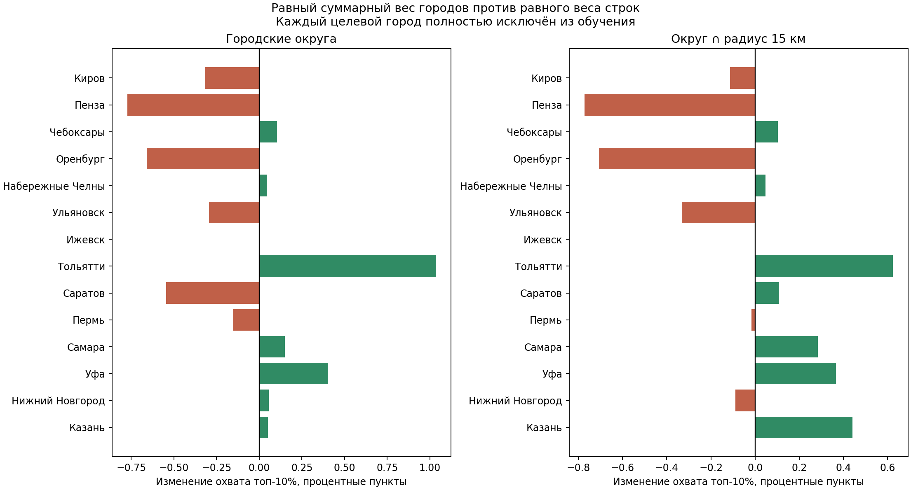

# Равный вклад населённых пунктов: проверка обучения с весами городов

2026-11-06. Цель пользователя: одинаково хорошо работать в каждом населённом пункте.
Основная единица оценки — целый исключённый населённый пункт с равным вкладом в среднюю метрику.
Численное равенство coverage между городами не гарантируется и не требуется: концентрация и шум ДТП различаются.
Поэтому показываются также нижняя четверть, худший город и отношение к реализованному ориентиру.

## Протокол

14 современных муниципальных когорт >350 тыс. из основного отчёта; результаты нельзя автоматически
обобщать на малые города, посёлки и сёла. Округ включает сельскую периферию; подвыборка радиусом 15 км
проверяется отдельно. Строго говоря, сейчас уравнивается вклад этих муниципальных когорт.

Для каждого целевого города модель обучается на остальных 13. 28 OSM-признаков, годовые строки
2015–2022, тест 2023–2025, три одинаковых сида 42/7/123. CatBoost Tweedie 1.3, 800/.05/6.
Параметры и формула весов зафиксированы без подбора. Старая модель с равными весами строк взята
из сохранённого основного эксперимента; новые 42 модели обучены с весом строки:

`w_i = N_total / (K_train_cities × N_rows_in_city)`.

Средний вес равен 1, суммарный вес каждого обучающего города одинаков. Проверка сохранена
в `reports/multicity_350k/equal_city_weights/weights.csv` для всех фолдов.
Число ДТП и набор строк не изменяются. Train-only p99-клиппинг остаётся тем же невзвешенным,
чтобы проверить именно изменение sample_weight; далее можно отдельно изучить подготовку признаков.
Информация о ДТП целевого города не участвует в обучении, вычислении весов или порогов.
Равный городской вклад в функцию потерь — проверяемое средство, а не гарантия равного качества.

## Результат

Среднее изменение coverage@10 по 14 городам: **-0.064 п.п.**.
Улучшение в 7, ухудшение в 6, без изменения в 1 городах.
Сравнение остальных показателей и таблица городов ниже важнее одного среднего значения.

| method | macro_cov10 | city_p25_cov10 | worst_city_cov10 | macro_fraction_realized | macro_abs_log_calib |
| --- | --- | --- | --- | --- | --- |
| row | 0.607 | 0.545 | 0.471 | 0.844 | 0.329 |
| equal | 0.606 | 0.545 | 0.472 | 0.844 | 0.314 |

Метрики coverage и отношение к реализованному ориентиру в таблице выше даны долями, ошибка
калибровки — `mean_city(abs(log(sum_pred/sum_observed)))`, меньше лучше. `city_p25_cov10` — 25-й
перцентиль качества городов; `worst_city_cov10` — минимальное качество. Это показатели
неоднородности результатов, они не выделяют причинный эффект веса на каждом типе территории.

| Город | Равные строки, % | Равные города, % | Δ, п.п. | ДИ Δ ансамбля, ниж. | ДИ Δ ансамбля, верх. |
| --- | --- | --- | --- | --- | --- |
| Казань | 59.945 | 59.997 | 0.051 | -0.622 | 1.321 |
| Нижний Новгород | 69.496 | 69.551 | 0.055 | -0.900 | 0.288 |
| Уфа | 66.509 | 66.913 | 0.404 | -0.700 | 1.037 |
| Самара | 50.724 | 50.874 | 0.150 | -0.907 | 1.280 |
| Пермь | 60.624 | 60.469 | -0.155 | -0.972 | 0.716 |
| Саратов | 77.463 | 76.919 | -0.545 | -1.269 | 0.285 |
| Тольятти | 48.070 | 49.103 | 1.033 | -1.046 | 1.548 |
| Ижевск | 58.392 | 58.392 | 0.000 | -1.384 | 1.581 |
| Ульяновск | 61.030 | 60.736 | -0.294 | -1.059 | 0.825 |
| Набережные Челны | 47.139 | 47.187 | 0.047 | -2.148 | 1.719 |
| Оренбург | 65.436 | 64.778 | -0.658 | -1.736 | 0.891 |
| Чебоксары | 53.182 | 53.285 | 0.103 | -2.327 | 0.915 |
| Пенза | 58.811 | 58.038 | -0.772 | -1.892 | 0.904 |
| Киров | 73.144 | 72.829 | -0.315 | -1.302 | 0.630 |



Основные точки — средние метрик трёх сидов. Интервалы для разности качества **ансамблей прогнозов**:
500 парных пересэмплирований пространственных блоков H3 res 7 внутри каждого города. Поэтому
среднее сидовых Δ и точка ансамбля могут немного различаться. Поправки на множественные сравнения нет.
`macro_deltas.csv` дополнительно содержит описательное пересэмплирование 14 городов;
фолды разделяют обучающие данные, поэтому это не строгий независимый ДИ для всех городов России.

## Интерпретация и ограничения

Предпочтение пользователя относится к цели оценки и сохраняется независимо от того, улучшает ли
конкретная формула весов результат. Нужно сравнивать одновременно macro, нижнюю четверть,
худшие территории, калибровку и нормирование на концентрацию событий.
Сильное улучшение среднего при ухудшении отдельных городов не означает выполнения цели «хорошо везде».
И наоборот, равные веса могут не помочь: разный поток, качество карты, состав ДТП и скрытые признаки
одним изменением весов не устраняются.

Исследование разведочное: эти города уже использованы для анализа и разработки. Любую выбранную
стратегию следует проверять на новых городах; малые населённые пункты нужны отдельно.
Современный OSM позднее теста, история сети не восстановлена; приоритеты и ограничения основного
отчёта сохраняются. Никаких весов по сходству и подбора их параметров в этом эксперименте нет.

## Воспроизведение

```
./venv/bin/python scripts/multicity_equal_city_weights.py
./venv/bin/python scripts/report_equal_city_weights.py
```

Нужны локальные кэши основного опыта. Численные таблицы находятся рядом с отчётом;
протокол, проверки весов и сырые метрики — `reports/multicity_350k/equal_city_weights`.
