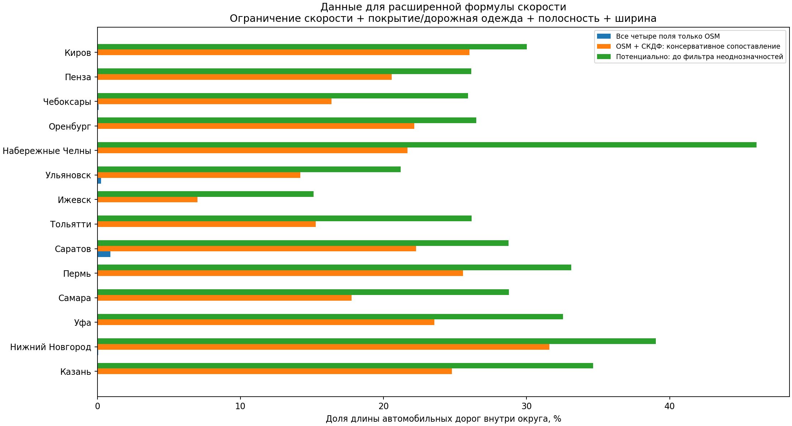
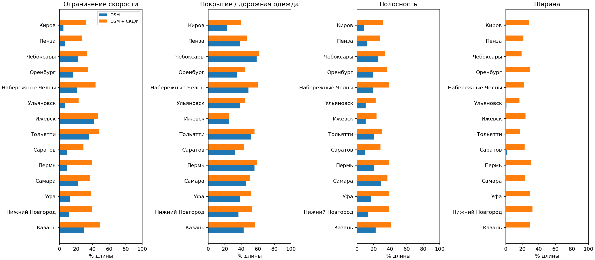

# Покрытие атрибутов для формулы скорости: OSM + СКДФ, 14 городов

2026-11-06. Это фактический аудит доступности атрибутов, а не проверка точности расчётной скорости.
Формула скорости пока является конструкцией: численные таблицы классов/покрытий и штрафов не утверждены.

## Главное

- Базовую скорость по классу можно назначить всем 285,932 объектам автомобильных дорог
  (50,706.1 км внутри округов). Это использование значений по умолчанию, без гарантии точности
  или навигационной доступности. Направления, барьеры, запреты и манёвры этим аудитом не проверены.
- Более требовательный вариант: явно известны ограничение скорости, покрытие/тип дорожной одежды,
  полосность и ширина. После консервативного сопоставления OSM ↔ СКДФ доступны 11,168.8 км,
  или **22.0%** общей длины. У 30,346 OSM-ways набор доступен на всей
  обследованной длине внутри округа.
- Только OSM обеспечивал все четыре поля на 0.15% общей длины.
- Использование точного материала OSM surface строже, чем крупного класса одежды СКДФ:
  эти варианты показаны отдельно. Не декодированные коды материала pavement_type_gid не выдаются за асфальт/грунт.
- Суммы объединённых муниципальных выгрузок описывают объекты внутри своих округов; возможные
  общие линии на административной границе могут считаться в обоих округах. Для сравнения городов
  используются отдельные знаменатели, глобальные суммы не заявляются как уникальная национальная сеть.

## Сколько объектов обеспечено данными

«Дорога» здесь — **OSM-way с ненулевой длиной внутри муниципального полигона**. Это не именованная
улица, не дорога целиком по реестру и не готовое направленное ребро маршрутизатора. Один way может
пересекать несколько паспортных участков с разным заполнением. Длина известной части учитывается
даже тогда, когда весь way не заполнен. Небольшие различия с H3-отчётом объясняются точным обрезанием
геометрии по полигону вместо выбора целых H3-ячеек по центроидам.

| Город | Всего объектов OSM | Длина сети, км | Полностью обеспечены, объектов | Обеспеченная длина, км | Обеспеченная длина, % |
| --- | --- | --- | --- | --- | --- |
| Казань | 33 652 | 5181.4 | 4 248 | 1283.5 | 24.8 |
| Нижний Новгород | 37 799 | 6707.7 | 5 913 | 2118.8 | 31.6 |
| Уфа | 17 100 | 3851.0 | 1 702 | 906.8 | 23.5 |
| Самара | 19 146 | 3563.9 | 1 732 | 632.9 | 17.8 |
| Пермь | 28 681 | 4621.7 | 2 795 | 1181.1 | 25.6 |
| Саратов | 29 734 | 5863.6 | 2 397 | 1306.8 | 22.3 |
| Тольятти | 11 494 | 2269.3 | 635 | 346.4 | 15.3 |
| Ижевск | 15 371 | 2667.4 | 378 | 186.8 | 7.0 |
| Ульяновск | 22 811 | 3613.0 | 1 663 | 512.4 | 14.2 |
| Набережные Челны | 13 415 | 1926.2 | 2 669 | 417.3 | 21.7 |
| Оренбург | 14 706 | 2982.2 | 1 675 | 660.8 | 22.2 |
| Чебоксары | 12 376 | 1907.0 | 1 386 | 312.2 | 16.4 |
| Пенза | 15 014 | 2597.4 | 1 642 | 534.5 | 20.6 |
| Киров | 14 633 | 2954.2 | 1 511 | 768.3 | 26.0 |

Полностью обеспеченный объект — все его образцы имеют четыре атрибута. Дополнительная менее строгая
оценка «≥90% длины way» и детальный вариант покрытия сохранены в `cities_summary_ru.csv`.
Геометрия обследуется образцами не реже 20 м: короткие разрывы между образцами могут быть пропущены,
поэтому «полностью» относится к обследованной длине с этой дискретизацией.




## Источники и сопоставление

- OSM: локальный PBF 2026-06-03; существующие буферные выгрузки 14 городов; все автомобильные
  классы, включая service. Отдельная таблица улиц без service — `street_without_service.csv`.
- СКДФ: свежая полная выгрузка для bbox каждого буферного округа, слой
  `skdf_open:lyr_road_conditions_road_normative_condition`, WFS
  `https://скдф.рф/api-geoserver/skdf_open/wfs`. Поля `speed_limit`, `lanes`, `roadway_width`,
  `pavement_kind_gid`, дополнительно сохранён `pavement_type_gid`. Старую саратовскую выгрузку не подменяли.
  Счётчики страниц и уникальность паспортных id проверены. Даты/параметры — `reports/route_proxy_coverage/metadata.json`.
- Обрезание дорог по современному муниципальному полигону, проекция местной зоны UTM.
  Участки СКДФ обрезаются полигоном с 50-м буфером для сопоставления у края территории.
- Для каждого образца OSM выбирается ближайший параллельный сегмент СКДФ: расстояние ≤20 м,
  разница направлений по модулю 180° ≤25°. Геометрические расстояния считаются до сегментов точно;
  дискретизация относится к местам проверки вдоль дороги.
- Если в пределах расстояния лучшего кандидата +5 м присутствует другой road_id или конфликтуют
  паспортные атрибуты, сопоставление считается неоднозначным и данные СКДФ для строгой оценки не используются.
  Это эвристика уверенности, не доказательство правильности оставшихся совпадений; названия/топология
  и реальные маршруты не проверены. Самый близкий кандидат при равных расстояниях выбирается детерминированно.
- На односторонние OSM-ways паспортные lanes/roadway_width **не переносятся**, поскольку СКДФ может
  описывать обе проезжие части суммарно. Если нужные поля уже есть в OSM, они используются.
  Это намеренно осторожное правило, которое недооценивает доступные данные для некоторых настоящих
  односторонних дорог. «Потенциальный» вариант показывает наличие до этих фильтров, не готовность к применению.

## Какие значения считаются известными

- Скорость: числовой maxspeed OSM (включая mph и RU:urban/rural/living_street) или speed_limit СКДФ,
  5–150 км/ч. При directional-тегах без общего значения требуются оба направления;
  для оценки заполненности берётся минимум. Полный профиль должен хранить направления раздельно.
- Полосность: целое 1–20. Допускается сумма известных lanes:forward/backward, когда нет общего lanes.
- Ширина: 1–100 м, распознаются обычные числовые значения и единицы m. Диапазоны и неоднозначные
  строки не принимаются. Это широкие фильтры правдоподобия, не сертификат фактической корректности.
- Покрытие: распознанный материал OSM surface или крупная расшифрованная категория дорожной одежды
  СКДФ. Неподтверждённые legacy-коды 2043912/2043913 не используются.
- Smoothness: только распознанные значения OSM, отдельно от типа дорожной одежды. Его наличие
  показывает осведомлённость о состоянии, но impassable означает невозможность проезда.

Назначение измеренной скорости по этим данным не выполняется: maxspeed и паспортная скорость — ограничения,
а действительная скорость зависит также от потока, светофоров и прочего. Отсутствующие параметры в
предложенной формуле могут оставаться нейтральными и давать базовый профиль. Поэтому неполный набор
четырёх атрибутов не означает, что ребро обязательно нужно удалять из графа.

## Проверки и воспроизводимость

В каждой муниципальной выборке проверены уникальность OSM id, баланс длины исходных линий
и суммарных весов образцов, границы долей [0;1]. Данные не переносятся с агрегатов H3 на отдельные дороги.
Подробности по классам — `coverage_by_class.csv`, все критерии — `coverage_long.csv`.
Результаты зависят от геометрической точности реестра и выбранных допусков; ручная проверка соответствий
и исследование других порогов пока не выполнены. Снимки OSM и СКДФ имеют разные даты.

```
./venv/bin/python scripts/fetch_multicity_skdf.py
./venv/bin/python scripts/route_attribute_coverage.py
./venv/bin/python scripts/report_route_attribute_coverage.py
```

Сырые GeoJSON — `data/raw/skdf/route_coverage_20261106`; покрытие каждого way —
`reports/route_proxy_coverage/ways/` (локальные parquet). Итоговые таблицы/метаданные —
`reports/route_proxy_coverage`; данные этого отчёта и рисунки — рядом с README.
